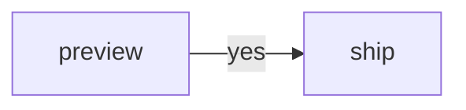

Prose with a break -- right here should be flagged.

Inline code like `a -- b` is skipped, and so is a [link](https://example.com/a--b/I've-got).



```recipe
toss the wings -- and enjoy
  chicken wings
```

    an indented code block -- also skipped

I've got one more, and Markdown is capitalized here.
